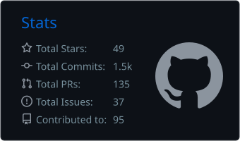
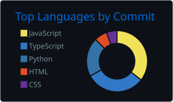

<div align="center">

[]()

<br/>

<a href="https://github.com/octavebahoun?tab=followers">

</a>

<a href="https://github.com/octavebahoun?tab=repositories&sort=stargazers">

</a>


</div>

<br/>

---

## 👋 À propos de moi

```python
class OctaveBahoun:
    def __init__(self):
        self.name = "Octave BAHOUN-HOUTOUKPE"
        self.role = "Ingénieur IA & DevOps"
        self.location = "Bénin 🇧🇯"
        self.languages = ["Français", "Anglais"]
        self.mission = "Concevoir des logiciels intelligents et des solutions évolutives"

    def current_focus(self):
        return [
            "🤖 Intelligence artificielle & Machine Learning",
            "🌐 Applications web full-stack",
            "⚙️ DevOps & systèmes backend",
            "☁️ Déploiement cloud et infrastructure",
            "🔐 Sécurité et architecture système"
        ]

    def fun_fact(self):
        return "J'aime transformer des idées techniques complexes en systèmes qui marchent vraiment."
```

---

## 📊 Statistiques GitHub

<div align="center">





</div>

<br/>

<div align="center">


</div>

---

## 🤝 Me contacter

<div align="center">

<a href="https://www.linkedin.com/in/octave-bahoun-b9114b337">

</a>

<a href="mailto:octavebahoun@gmail.com">

</a>

<a href="https://github.com/octavebahoun">

</a>

</div>

<br/>

<div align="center">

**💬 Ouvert aux collaborations et aux missions freelance !**

*Une idée, un projet ou un défi technique ? Construisons quelque chose de génial ensemble.*

</div>

<br/>


